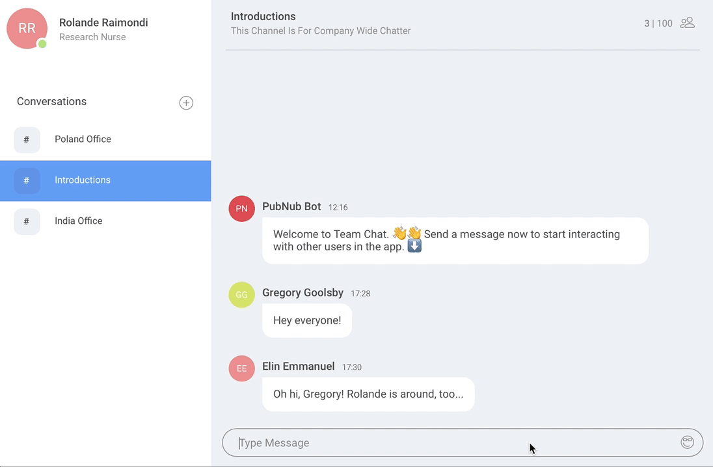
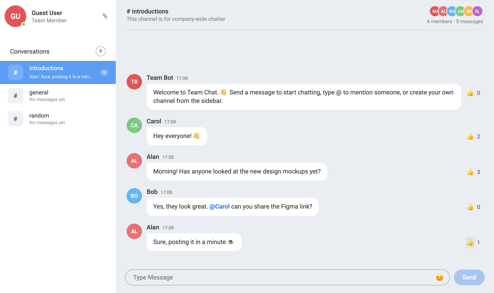
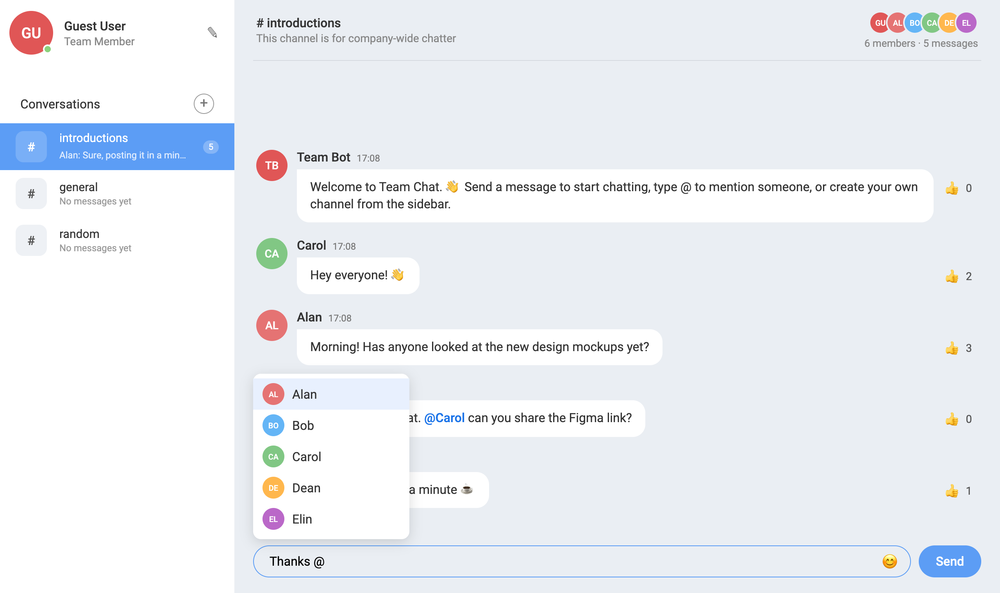
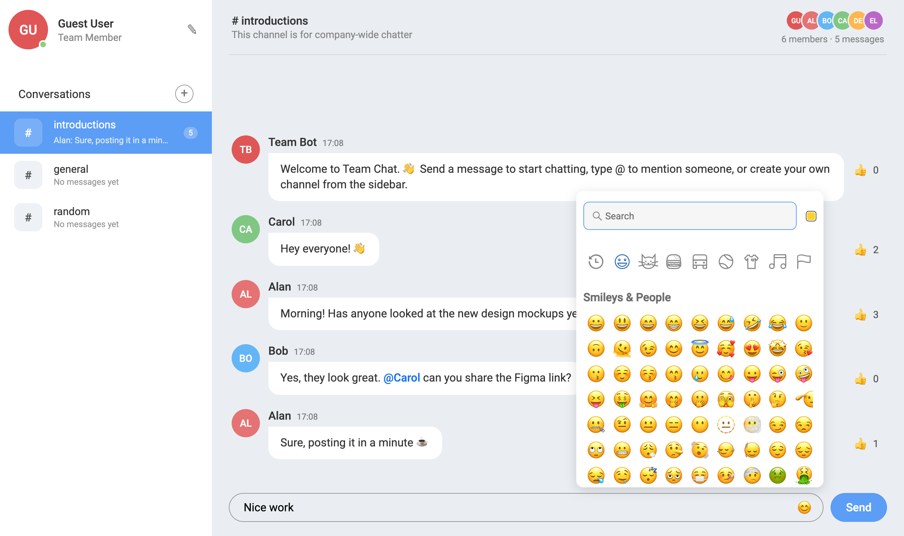
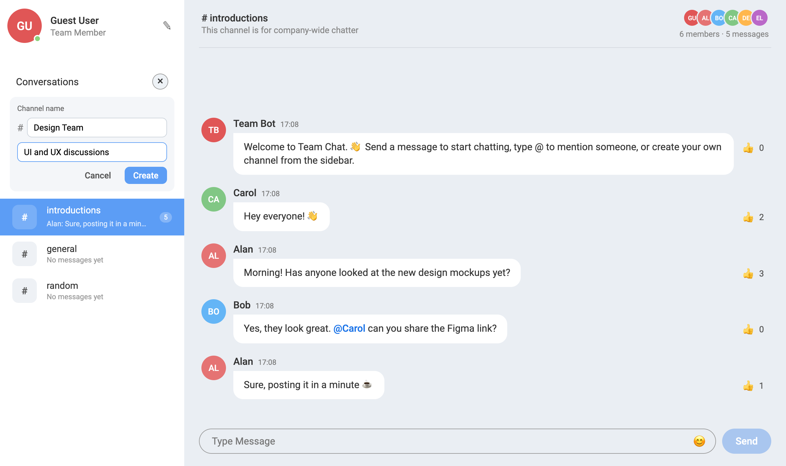
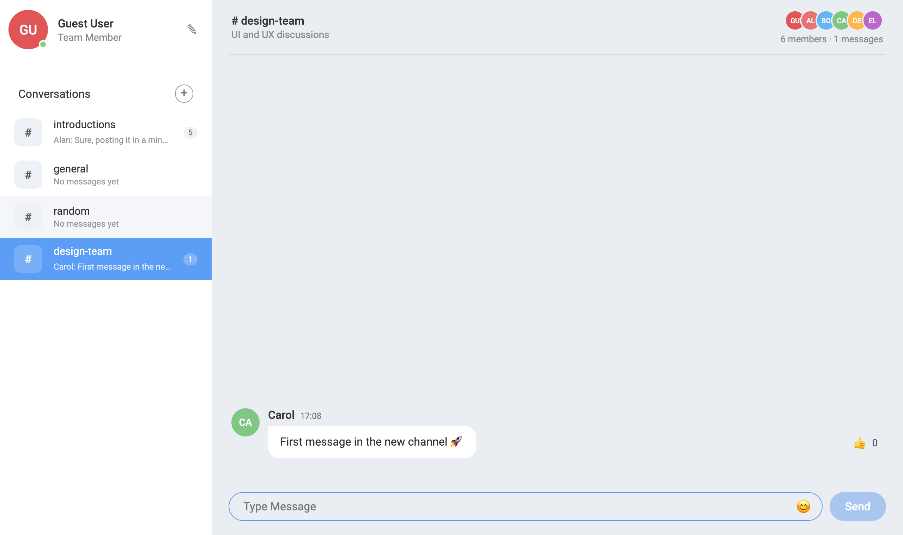
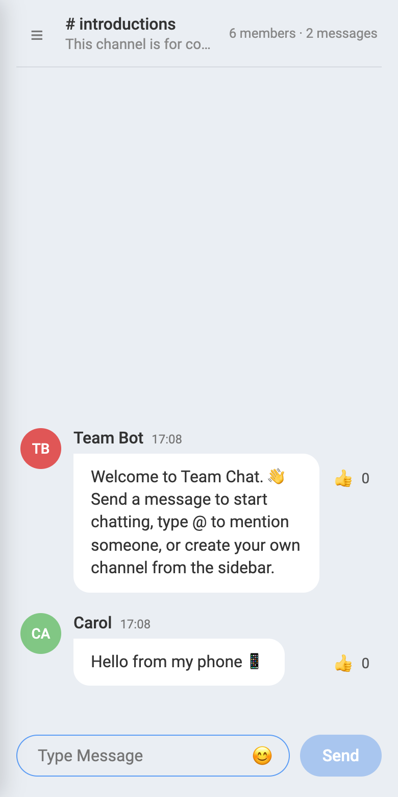
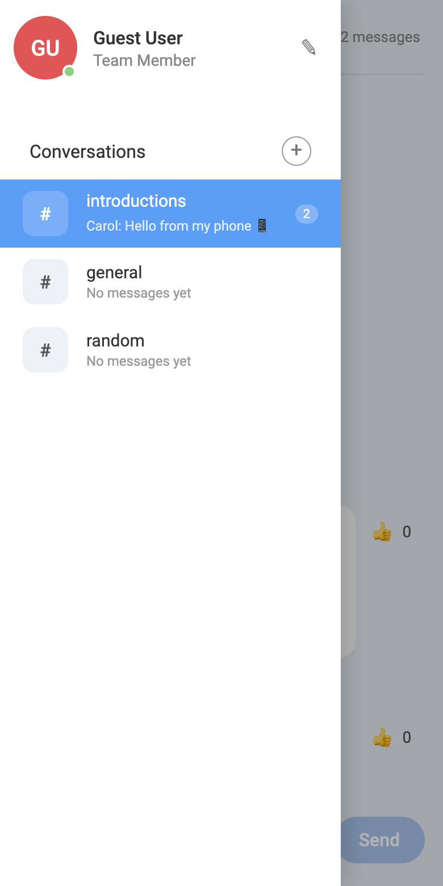

# React Team Chat

A responsive team chat single-page application built with React and Vite featuring channels, message history, likes, emojis, and @mentions.

Reference design:


---

## Live Preview & Screenshots

**Chat thread** with random users, interactive like counts and highlighted @mentions:



| @mentions Dropdown | Emoji Picker |
| --- | --- |
|  |  |

| Creating a Channel | New Channel with Dedicated History |
| --- | --- |
|  |  |

**Mobile Layout**

<p>
  
  &nbsp;&nbsp;
  
</p>

---

## Features

### Core Requirements
- [x] **Message Input & Send**: Single-page chat interface with text input and send button.
- [x] **Message Thread**: Real-time rendering of chat messages above the input bar.
- [x] **Random User Assignment**: Automatically assigns a random username on each message from `["Alan", "Bob", "Carol", "Dean", "Elin"]`.
- [x] **Like Button & Counter**: Each chat message features an interactive like button at the right end with an incrementing counter.

### Stretch Goals
- [x] **Emojis**: Full-featured emoji picker with category tabs, search, recent emojis, and skin tone selector (via `emoji-picker-react`). Dynamically/lazily loaded when opened to keep initial bundle size minimal.
- [x] **@Mentions**: Typing `@` triggers user search dropdown. Supports keyboard navigation (↑/↓ to navigate, Enter/Tab to select, Esc to close) and click selection. Mentions are highlighted with custom badge styling in sent messages.

### Extra Features & Architecture
- **Sidebar & Profile Card**: Displays current user avatar with initials, online status badge, username, and role. Supports editing profile details with instant local persistence.
- **Multiple Channels**: Starts with default channels (`#introductions`, `#general`, `#random`). Supports creating custom channels with descriptions and auto-slugified names.
- **Channel Header**: Displays channel name, description, active member avatars, and total message counts.
- **State Persistence**: Channels, message history, likes, and profile settings are stored in `localStorage` through a custom `usePersistentState` hook.
- **Responsive Drawer**: Desktop dual-pane layout seamlessly transitions into an off-canvas slide-out drawer on mobile viewports (< 768px).

---

## Tech Stack

- **Framework**: React 19
- **Build Tool**: Vite 8
- **Styling**: Vanilla CSS (CSS variables, modern flexbox & grid)
- **Icons & Emojis**: `emoji-picker-react`
- **Linting**: oxlint

---

## Getting Started

### Prerequisites
- Node.js 20+ or 22+
- npm

### Installation & Run

1. Clone the repository:
```bash
git clone https://github.com/aashutosh-k-das/react-team-chat.git
cd react-team-chat
```

2. Install dependencies:
```bash
npm install
```

3. Start development server:
```bash
npm run dev
```

4. Build for production:
```bash
npm run build
npm run preview
```

5. Run linter:
```bash
npm run lint
```

---

## Project Structure

```
├── assets/                  # Demo GIF and preview screenshots
├── public/                  # Static assets (favicon)
├── src/
│   ├── components/
│   │   ├── Avatar.jsx            # Coloured initials avatar badge
│   │   ├── ChannelHeader.jsx     # Header with channel info and member avatars
│   │   ├── ChatInput.jsx         # Message input, emoji trigger, @mention logic
│   │   ├── ChatMessage.jsx       # Individual message item with like button
│   │   ├── CreateChannelForm.jsx # New channel creation modal/form
│   │   ├── EmojiPicker.jsx       # Lazy-loaded wrapper around emoji-picker-react
│   │   ├── MentionList.jsx       # @mention autocomplete dropdown
│   │   ├── ProfileCard.jsx       # Current user profile card with edit modal
│   │   └── Sidebar.jsx           # Channels list, unread/message stats, drawer
│   ├── App.jsx                   # Main layout and channel state management
│   ├── App.css                   # Component-level layout & styling
│   ├── constants.js              # User list, colors, default channels
│   ├── index.css                 # Global CSS variables & reset
│   ├── main.jsx                  # React DOM root entry
│   └── usePersistentState.js     # Custom hook for localStorage sync
├── .gitignore
├── .oxlintrc.json
├── index.html
├── package.json
├── vite.config.js
└── README.md
```
